<div align="center">
  
</div>

<div align="center">
  <br />
  <a href="https://edu-ferreira.vercel.app"></a>
  <a href="https://www.linkedin.com/in/eduardo-alexandre-java/"></a>
  <a href="https://github.com/iHadesj?tab=repositories"></a>
</div>

## E aí, sou o Edu

Dev full stack, 20 anos, do Grajaú, zona sul de SP. Passei 20 meses na VTT trabalhando com digital signage e retail media pro varejo, e hoje tô procurando a próxima vaga como full stack ou front-end.

Gosto de fazer o app funcionar primeiro e depois foco na estética: regra de negócio no lugar certo, sem lotar de estados, rápido e fácil de usar. Meu dia a dia é React, Next.js e TypeScript. No back, minha base é Java, JPA e PostgreSQL.

- Interface responsiva e acessível 
- Regra de negócio, estado global, persistência local e fluxo assíncrono
- PWA com offline-first, teste automatizado e otimização de performance
- Animação e 3D só quando ajudam, não pra encher a tela

## Stack

<div align="center">

**Frontend**


**Backend, dados e testes**


</div>

<details>
  <summary><strong>O resto do que eu já usei</strong></summary>
  <br />

  `TanStack Query` · `React Router` · `Zustand` · `Dexie` · `JPA` · `Tomcat` · `Resend` · `Velite` · `React Email` · `Radix UI` · `Fuse.js` · `Workbox` · `ESLint` · `Prettier`
</details>

## Projetos


<table>
  <tr>
    <td width="50%" valign="top">
      <h3>Levva — Loja & Sorte</h3>
      <p><strong>E-commerce gamificado, meu laboratório de produto.</strong></p>
      <p>PWA com catálogo de 400 produtos, busca fuzzy, carrinho/checkout com dinheiro em centavos, cassino/gacha com RTP auditável, 29 testes, offline-first.</p>
      <p><code>React</code> <code>TypeScript</code> <code>Zustand</code> <code>Dexie</code> <code>Vitest</code> <code>PWA</code></p>
      <a href="https://github.com/iHadesj/Levva-loja-e-sorte"><strong>Ver projeto →</strong></a>
    </td>
    <td width="50%" valign="top">
      <h3>Portfólio Pessoal</h3>
      <p><strong>Minha experiência transformada em site.</strong></p>
      <p>Site spec-driven: 3D lazy-loaded (230 KB gz), animações com Motion, testes unitários + e2e, validação Zod, conteúdo tipado.</p>
      <p><code>Next.js</code> <code>React</code> <code>TypeScript</code> <code>Tailwind v4</code> <code>Three.js</code></p>
      <a href="https://github.com/iHadesj/EduardoFerreira"><strong>Ver código →</strong></a>
    </td>
  </tr>
  <tr>
    <td width="50%" valign="top">
      <h3>change_in_the_house_of_flies</h3>
      <p><strong>Música transformada em UI interativa.</strong></p>
      <p>Espectro realtime via Web Audio API, letra sincronizada (.lrc), Media Session API, refrão dispara intensidade visual (halo, zoom, tremor).</p>
      <p><code>JavaScript</code> <code>Web Audio API</code> <code>Vite</code></p>
      <a href="https://github.com/iHadesj/change_in_the_house_of_flies"><strong>Ver projeto →</strong></a>
    </td>
    <td width="50%" valign="top">
      <h3>DevTrack</h3>
      <p><strong>Tracker de progresso de estudos e projetos.</strong></p>
      <p>Foco em produtividade dev: organização de tarefas, métricas de tempo, visualização de evolução.</p>
      <p><code>TypeScript</code></p>
      <a href="https://github.com/iHadesj/DevTrack"><strong>Ver projeto →</strong></a>
    </td>
  </tr>
  <tr>
    <td width="50%" valign="top">
      <h3>API Java + PostgreSQL</h3>
      <p><strong>CRUD limpo em arquitetura MVC.</strong></p>
      <p>Controller → Service → Repository, consultas versionadas em SQL, testes com JUnit.</p>
      <p><code>Java</code> <code>Spring</code> <code>JPA/Hibernate</code> <code>PostgreSQL</code> <code>JUnit</code></p>
      <a href="https://github.com/iHadesj/JPA_PostgreSQL"><strong>Ver projeto →</strong></a>
    </td>
    <td width="50%" valign="top">
      <h3>Projeto CRUD</h3>
      <p><strong>Base de CRUD com JDBC/MySQL.</strong></p>
      <p>Fundamentos de persistência: conexão, statements, transações, padrão DAO.</p>
      <p><code>Java</code> <code>JDBC</code> <code>MySQL</code></p>
      <a href="https://github.com/iHadesj/Projeto_CRUD"><strong>Ver projeto →</strong></a>
    </td>
  </tr>
</table>

No lado Java, tem o [Projeto_CRUD](https://github.com/iHadesj/Projeto_CRUD) e o [JPA_PostgreSQL](https://github.com/iHadesj/JPA_PostgreSQL), onde pratiquei a base do backend.

## Como eu encaro meus projetos

```text
ideia → regra de negócio → experiência → código → teste → evolução
```

Projeto pessoal pra mim não é só tela bonita. É onde eu treino o que faria num produto de verdade: estrutura de domínio, tela de erro e de vazio, persistência, performance e documentação. Quando é simulação, eu deixo claro onde ela termina e onde começaria um sistema de produção.

## Experiência

**VTT (Vector Two Technologies)** · Desenvolvedor Web · fev. 2025 a out. 2026

Projetos de digital signage e retail media pra varejo. Entrei sabendo HTML, CSS, JavaScript, Java e MySQL e saí com React, Tomcat e mais noção de arquitetura de sistema.

## Contato

Curtiu algum projeto ou quer trocar ideia sobre vaga? Me chama no [LinkedIn](https://www.linkedin.com/in/eduardo-alexandre-java/) ou dá uma olhada no [portfólio](https://edu-ferreira.vercel.app).
