<!-- gerado por src/readme.mjs (npm run build): edite src/profile.mjs, não este arquivo -->

<code>cat README.txt</code> — versão em texto, sem animação

**Edu Ferreira** · full stack dev · 20 anos · grajaú, zona sul de sp

Dev full stack, 20 anos, do Grajaú, zona sul de SP. Passei 20 meses na VTT trabalhando com digital signage e retail media pro varejo, e hoje tô procurando a próxima vaga como full stack ou front-end.

Gosto de fazer o app funcionar primeiro e depois foco na estética: regra de negócio no lugar certo, sem lotar de estados, rápido e fácil de usar. Meu dia a dia é React, Next.js e TypeScript. No back, minha base é Java, JPA e PostgreSQL.

- `~/foco/interface-responsiva-e-acessivel/`
- `~/foco/regra-de-negocio+estado-global/`
- `~/foco/pwa-offline-first+testes+performance/`
- `~/foco/animacao-e-3d-so-quando-ajudam/`

**Stack:** React, Next.js, TypeScript, JavaScript, Tailwind CSS, Three.js, Java, PostgreSQL, MySQL, Vitest, Zod, Git  
**Também:** html, css, motion, indexeddb, tanstack query, react router, zustand, dexie, jpa, tomcat, playwright, radix ui, resend, react email, velite, fuse.js, workbox, eslint, prettier

**Projetos**

- [Levva — Loja & Sorte](https://github.com/iHadesj/Levva-loja-e-sorte) — E-commerce gamificado, meu laboratório de produto. PWA com catálogo de 400 produtos, busca fuzzy, carrinho/checkout com dinheiro em centavos, cassino/gacha com RTP auditável, 29 testes, offline-first. `react` `typescript` `zustand` `dexie` `vitest` `pwa`
- [Portfólio Pessoal](https://github.com/iHadesj/EduardoFerreira) — Minha experiência transformada em site. Site spec-driven: 3D lazy-loaded (230 KB gz), animações com Motion, testes unitários + e2e, validação Zod, conteúdo tipado. `next.js` `react` `typescript` `tailwind v4` `three.js`
- [change_in_the_house_of_flies](https://github.com/iHadesj/change_in_the_house_of_flies) — Música transformada em UI interativa. Espectro realtime via Web Audio API, letra sincronizada (.lrc), Media Session API, refrão dispara intensidade visual (halo, zoom, tremor). `javascript` `web audio api` `vite`
- [DevTrack](https://github.com/iHadesj/DevTrack) — Tracker de progresso de estudos e projetos. Foco em produtividade dev: organização de tarefas, métricas de tempo, visualização de evolução. `typescript`
- [API Java + PostgreSQL](https://github.com/iHadesj/JPA_PostgreSQL) — CRUD limpo em arquitetura MVC. Controller → Service → Repository, consultas versionadas em SQL, testes com JUnit. `java` `spring` `jpa/hibernate` `postgresql` `junit`
- [Projeto CRUD](https://github.com/iHadesj/Projeto_CRUD) — Base de CRUD com JDBC/MySQL. Fundamentos de persistência: conexão, statements, transações, padrão DAO. `java` `jdbc` `mysql`

**VTT · Vector Two Technologies** · desenvolvedor web · 2025.02 a 2026.10  
Projetos de digital signage e retail media pro varejo. Entrei sabendo HTML, CSS, JavaScript, Java e MySQL e saí com React, Tomcat e mais noção de arquitetura de sistema.

`ideia → regra de negócio → experiência → código → teste → evolução`

projeto pessoal não é só tela bonita: é onde eu treino o que faria num produto de verdade — estrutura de domínio, tela de erro e de vazio, persistência, performance e documentação. quando é simulação, deixo claro onde ela termina e onde começaria um sistema de produção.

curtiu algum projeto ou quer trocar ideia sobre vaga? é só chamar: [linkedin](https://www.linkedin.com/in/eduardo-alexandre-java/) · [portfólio](https://edu-ferreira.vercel.app) · [repositórios](https://github.com/iHadesj?tab=repositories)

tudo acima é gerado por código: o rosto é um modelo 3D feito com SDFs e ray marching, convertido em ASCII no build. sem foto, sem gif. veja <a href="src/">src/</a>.
