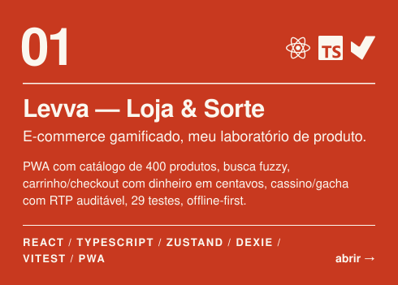
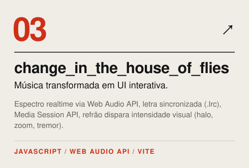
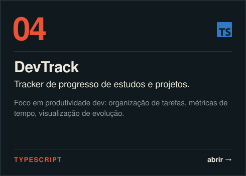
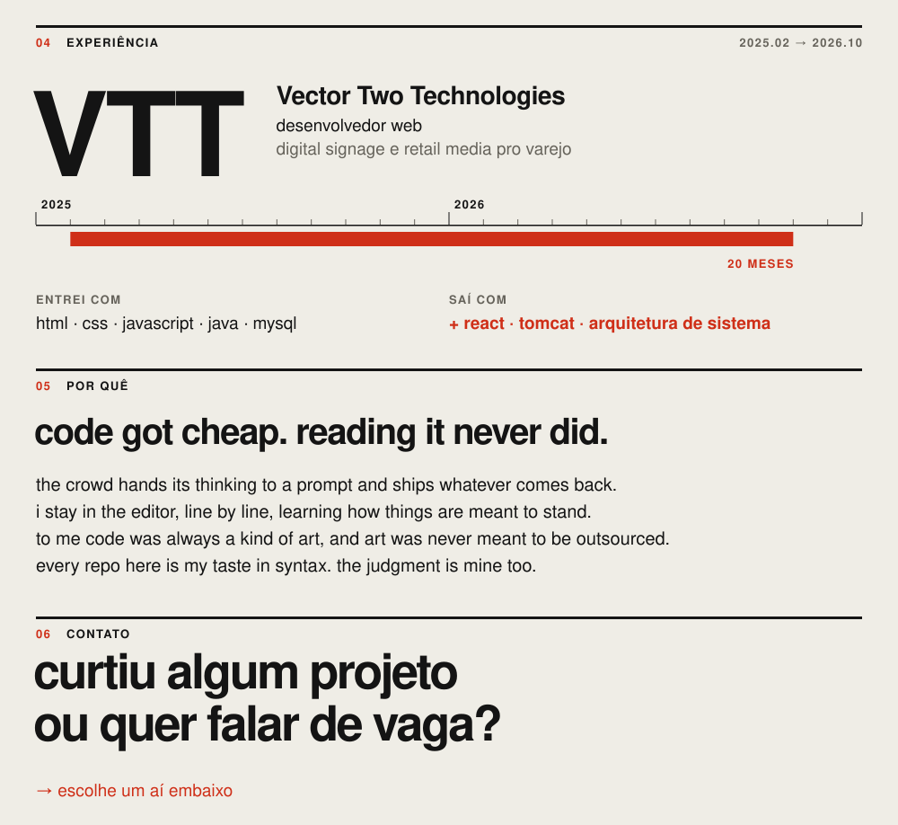

<!-- gerado por src/readme.mjs (npm run build): edite src/profile.mjs, não este arquivo -->

versão em texto

**Edu Ferreira** · full stack dev · 20 anos · grajaú, zona sul de sp · procurando vaga: full stack ou front-end

Dev full stack, 20 anos, do Grajaú, zona sul de SP. Passei 20 meses na VTT trabalhando com digital signage e retail media pro varejo, e hoje tô procurando a próxima vaga como full stack ou front-end.

Gosto de fazer o app funcionar primeiro e depois foco na estética: regra de negócio no lugar certo, sem lotar de estados, rápido e fácil de usar. Meu dia a dia é React, Next.js e TypeScript. No back, minha base é Java, JPA e PostgreSQL.

**front-end:** React, Next.js, TypeScript, Tailwind CSS, Three.js  
**back-end · dados:** Java, JPA / Hibernate, PostgreSQL, MySQL, Tomcat  
**estado · qualidade:** Zustand, IndexedDB, Vitest, Zod, Git  
**também:** html, css, motion, tanstack query, react router, playwright, radix ui, resend, react email, velite, fuse.js, workbox, web audio api, eslint, prettier

01. [Levva — Loja & Sorte](https://github.com/iHadesj/Levva-loja-e-sorte) — E-commerce gamificado, meu laboratório de produto. PWA com catálogo de 400 produtos, busca fuzzy, carrinho/checkout com dinheiro em centavos, cassino/gacha com RTP auditável, 29 testes, offline-first. `react` `typescript` `zustand` `dexie` `vitest` `pwa`
02. [Portfólio Pessoal](https://github.com/iHadesj/EduardoFerreira) — Minha experiência transformada em site. Site spec-driven: 3D lazy-loaded (230 KB gz), animações com Motion, testes unitários + e2e, validação Zod, conteúdo tipado. `next.js` `react` `typescript` `tailwind v4` `three.js`
03. [change_in_the_house_of_flies](https://github.com/iHadesj/change_in_the_house_of_flies) — Música transformada em UI interativa. Espectro realtime via Web Audio API, letra sincronizada (.lrc), Media Session API, refrão dispara intensidade visual (halo, zoom, tremor). `javascript` `web audio api` `vite`
04. [DevTrack](https://github.com/iHadesj/DevTrack) — Tracker de progresso de estudos e projetos. Foco em produtividade dev: organização de tarefas, métricas de tempo, visualização de evolução. `typescript`
05. [API Java + PostgreSQL](https://github.com/iHadesj/JPA_PostgreSQL) — CRUD limpo em arquitetura MVC. Controller → Service → Repository, consultas versionadas em SQL, testes com JUnit. `java` `spring` `jpa/hibernate` `postgresql` `junit`
06. [Projeto CRUD](https://github.com/iHadesj/Projeto_CRUD) — Base de CRUD com JDBC/MySQL. Fundamentos de persistência: conexão, statements, transações, padrão DAO. `java` `jdbc` `mysql`

**Vector Two Technologies** · desenvolvedor web · 2025.02 a 2026.10  
digital signage e retail media pro varejo. entrei com html, css, javascript, java, mysql; saí com react, tomcat, arquitetura de sistema.

> code got cheap. reading it never did.  
> the crowd hands its thinking to a prompt and ships whatever comes back.  
> i stay in the editor, line by line, learning how things are meant to stand.  
> to me code was always a kind of art, and art was never meant to be outsourced.  
> every repo here is my taste in syntax. the judgment is mine too.  

curtiu algum projeto ou quer falar de vaga? [LinkedIn](https://www.linkedin.com/in/eduardo-alexandre-java/) · [Portfólio](https://edu-ferreira.vercel.app) · [Repositórios](https://github.com/iHadesj?tab=repositories)

